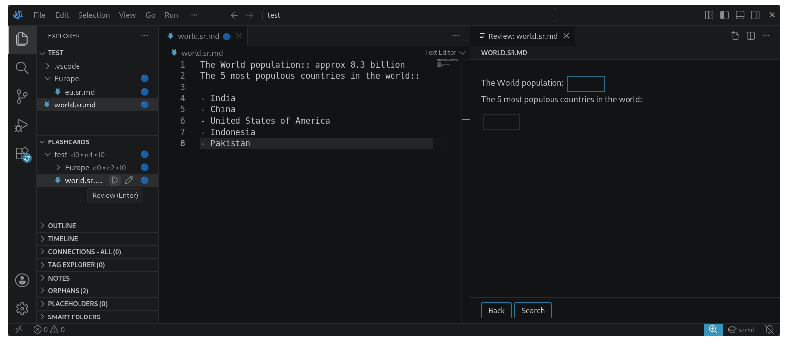

# srmd

A flashcard spaced repetition extension for Markdown suitable for knowlege base notes that plays nice with [Foam](https://foambubble.github.io/foam/) but does not require it. Flashcards typically isolate facts, while knowledge-base notes organize related information and evolve over time. Keeping both synchronized duplicates work. Using unobtrusive cloze and scheduling Markdown syntax srmd generates flashcards from knowledge-base notes: note-taking first, spaced repetition second.



Markdown is parsed using [markdown-it](https://github.com/markdown-it/markdown-it) and srmd's syntax extension. Reviews are scheduled with [ts-fsrs](https://github.com/open-spaced-repetition/ts-fsrs), the TS implementation of the [FSRS algorithm](https://github.com/open-spaced-repetition/awesome-fsrs/wiki/The-Algorithm).

```markdown
The World population:: approx 8.3 billion

The 5 most populous countries in the world:: 

- India
- China
- United States of America
- Indonesia
- Pakistan
```

Note taking comes first. A note stays readable Markdown and the extension syntax, srmd, is aimed at being as unobtrusive as possible with the FSRS scheduling stored in the note itself. Once a card has been reviewed, a card reference such as `[:1]` ends its first cloze and a one-line card definition holds its scheduling, at the end of the note unless the note already has definitions:

```markdown
The World population:: approx 8.3 billion[:1]

The 5 most populous countries in the world:: 

- India
- China
- United States of America
- Indonesia
- Pakistan

[:1]: k 20261016040000 1 20261015120000 2.3065 2.11810397 0 1 0
```
There is no database or srmd service. Notes move, rename and sync with whatever you already use, such as Git or Syncthing. Loading a note never rewrites it; only a review, or a manual scheduling hint the user wrote, saves it.

## Status

There are two applications: a VS Code extension and an Android app. The VS Code extension covers:

- A Flashcards view in the Explorer side bar for navigating flashcards and reviewing.
- Count badges in the regular Explorer (VS Code design choices are not optimal for srmd, there is no reliable way to display badges for folders as they get suppressed by the bubbling badge).
- A review tab that follows the VS Code theme.
- A reading view of notes in VS Code's Markdown preview, with every cloze shown and outlined.
- Warnings for notes whose card definitions a save would remove.
- Foam and other VS Code Markdown syntax extensions work in srmd views and flashcards.

It is off in every workspace until turned on, from the Command Palette or the status bar, so other projects are never scanned. See [apps/vscode/README.md](apps/vscode/README.md) for its features, commands, keyboard shortcuts and settings.

The Android app is primarily a tool for viewing and reviewing a knowledge base folder tree. It shows the notes folder you pick, full screen with every cloze outlined; swipe right for the folder tree with the cards' counts, swipe up to search the shown file. It reviews notes as the VS Code review tab does and edits files with [CodeMirror](https://codemirror.net/). The android app currently has no extension API so it bundles some of Foam to be able to render Foams Markdown syntax extensions. See [apps/android/README.md](apps/android/README.md).

A browser application is tentatively planned. An iOS app will require someone else as I do not own a single Apple device. The code base is split into a portable components (`shared/`) and the platform specific components (`apps/`) to minimize the platform specific code.

## Documentation

| Document                                                     | Contents                                                                                                           |
|--------------------------------------------------------------|--------------------------------------------------------------------------------------------------------------------|
| [apps/vscode/README.md](apps/vscode/README.md)               | Using the VS Code extension                                                                                        |
| [apps/android/README.md](apps/android/README.md)             | Using the Android app                                                                                              |
| [apps/android/ARCHITECTURE.md](apps/android/ARCHITECTURE.md) | The Android app's design: the Kotlin shell, the web app and their message channel                                  |
| [SYNTAX.md](SYNTAX.md)                                       | Writing notes in srmd: clozes, card references and definitions, loading and saving                                 |
| [ARCHITECTURE.md](ARCHITECTURE.md)                           | The canonical design: the components and their contracts, queues, loading, reviewing and the hosts                 |
| [shared/parser/README.md](shared/parser/README.md)           | The note inspector                                                                                                 |
| [tests/README.md](tests/README.md)                           | Running and writing tests                                                                                          |
| [AGENTS.md](AGENTS.md)                                       | Code conventions and component boundaries                                                                          |

## Repository layout

An npm workspaces monorepo in TypeScript: the portable components in `shared/`, the VS Code and Android hosts in `apps/`, and Foam's repository as a Git submodule in `foam/`. Hosts stay thin; they provide file access, configuration, resource URLs and a review surface, and the shared components do the rest. [ARCHITECTURE.md](ARCHITECTURE.md#code-base) lists the components.

Repository-wide tools live in root `scripts/`, with their tests in root `tests/`. Component-specific build, packaging and debug scripts stay with the component that uses them.

## Development

Install Node 20.19 or later. Clone with the Foam submodule, or fetch it in a clone made without, then install dependencies once at the repository root:

```sh
git clone --recurse-submodules <repository>    # or, in an existing clone: git submodule update --init
npm install
```

| Command                                      | Effect                                                                                                       |
|----------------------------------------------|--------------------------------------------------------------------------------------------------------------|
| `npm test`                                   | All tests: repository scripts, shared components, then both hosts                                           |
| `npm run test:scripts`                       | Repository tooling tests, including Foam updates against temporary Git repositories                         |
| `npm run test:<name>`, such as `test:parser` | One component's tests: `parser`, `scheduler`, `reviewer`, `ui`, `workspace`, `shared`, `vscode` or `android` |
| `npm run typecheck`                          | Type-check every component and both hosts                                                                    |
| `npm run build`                              | Bundle the extension into `apps/vscode/dist/` and the Android web app into its assets                        |
| `npm run build:foam`                         | Compile the Foam core library used by Android builds and tests                                               |
| `npm run package:android`                                | Build the Android app's debug APK (see below)                                                                |
| `npm run parse -- path/to/note.sr.md`        | Inspect how a note parses, renders and would be saved, without changing it                                   |

Tests use Node's test runner and import TypeScript sources directly through `tsx`. The VS Code tests run the real extension and webview bundles against a mocked `vscode` module, so they need no VS Code installation. Running `npm test` in a component's directory runs only its tests. See [tests/README.md](tests/README.md) for filtering and conventions.

To try changes in VS Code, build, then start an Extension Development Host with `--extensionDevelopmentPath` pointing at `apps/vscode`, and open a folder of notes.

### Building the extension

```sh
npm run package:vscode
code --install-extension apps/vscode/srmd.vsix
```

`package:vscode` builds the extension and packages it with the locally installed `vsce` into `apps/vscode/srmd.vsix`. The extension needs VS Code 1.85 or later.

### Building the Android app

```sh
JAVA_HOME=/path/to/jdk npm run package:android
adb install apps/android/native/app/build/outputs/apk/debug/app-debug.apk
```

`package:android` bundles the web app into the Gradle project's assets, then builds the debug APK with Gradle. It needs a JDK 17 or later, one with `javac`, and the Android SDK, found through `ANDROID_HOME` or `sdk.dir` in `apps/android/native/local.properties`; the Android Gradle plugin installs the SDK platform and build tools it lacks. The app needs Android 10 or later. To try the web app without a device, `node apps/android/tests/browser.mjs <notes folder>` serves it with a stand-in for the Android shell, for a desktop browser's device emulation.

### Debugging the Android app

In VS Code, select **srmd: Android WebView** in Run and Debug and press F5. Its preparation task builds the APK,
reuses a connected device or starts the installed `pixel_test` emulator, installs the app without clearing its data,
and attaches the JavaScript debugger on port 9223. Breakpoints work in `apps/android/src/` and the shared TypeScript
components. To catch startup breakpoints, run `location.reload()` in the Debug Console after attaching.
Run `ANDROID_HOME="$HOME/Android" ANDROID_AVD_HOME="$HOME/Android/avd" npm run debug:android` for the same preparation
from a terminal; then the WebView is also available through
[Chrome's device inspector](https://developer.chrome.com/docs/devtools/remote-debugging).

The VS Code task selects the SDK at `~/Android` and virtual devices at `~/Android/avd`; change its environment entries
for another installation. The preparation script uses `ANDROID_HOME` (default `~/Android`) and `ANDROID_AVD_HOME`
(default `<SDK>/avd`), dropping the deprecated `ANDROID_SDK_ROOT` to avoid conflicting SDK locations.
Set `SRMD_ANDROID_AVD` for a different installed emulator, or `ANDROID_SERIAL` to select a connected
device when more than one is present. Java must be on PATH or selected through `JAVA_HOME`. Emulator startup output
goes to `apps/android/build/emulator.log`. Stop and restart debugging after changing code to rebuild and reinstall;
the emulator stays running. For Kotlin breakpoints, open `apps/android/native/` in Android Studio.

### Performance

There is one important hot path, startup: find all files in scope, read from disk, parse and build scheduling queues. Remaining code paths are triggered on individual note basis through user interaction so performance there is generally not a concern.

### App versions

The root `package.json` sets the version of both apps. Change that version once; app builds synchronize the VS Code and Android package manifests and their lockfile entries automatically. `npm run sync:version` performs just that synchronization. VSIX packaging and Android's native build read the root version directly, and Android shows the bundled version beside the Settings title.

Android derives its numeric `versionCode` as `major * 1000000 + minor * 1000 + patch` (minor and patch must be below 1000). Version suffixes do not change this code; increment the numeric version for each published Android update.

### Dependencies

External dependencies use open-ended ranges (`>=` the version last tested), and `package-lock.json` pins what is installed. Update them deliberately and rerun all tests. The one exception is `@types/vscode`, which matches the minimum VS Code version in `engines.vscode`, so the typecheck rejects APIs that version lacks.

Foam is pinned separately by its Git submodule commit. To update it to the latest published stable Foam release:

```sh
npm run update:foam
```

The root script `scripts/update_foam.mjs` uses the tag of Foam's latest GitHub release (`vscode@...`), which includes both its preview pipeline and core library. To select a particular release or an inter-release fix, pass its tag or full commit SHA:

```sh
npm run update:foam -- vscode@0.48.0
npm run update:foam -- 7a2e6322952f4fb2640113cc93f7af8f334bc67c
```

Both forms refuse uncommitted changes inside `foam/`, check out the selected commit, run `npm install`, type-check all components and run all tests. A failure stops the command and leaves the selected checkout available for investigation. After success, review `git diff --submodule=log -- foam package-lock.json` and commit the submodule pointer and any lockfile changes together. Normal builds keep using the pinned commit.

An explicit commit is resolved locally first; only a missing commit is fetched from `origin`. For a fix awaiting upstream merge, create a branch inside `foam/` (`git -C foam switch -c srmd-patch`), commit the patch there, and pass the full SHA printed by `git -C foam rev-parse HEAD` to `npm run update:foam -- <sha>`. Selecting that commit needs no Git fetch or release lookup. The updater detaches the checkout but retains your patch branch.

You can build and ship binaries from that local commit. To let fresh clones and CI reproduce the build, publish the patch branch to a reachable fork and set Foam's URL in `.gitmodules` to that fork, committing the URL change along with the submodule pin. The parent repository stores only the commit ID, not Foam's commit objects. Keep upstream release tags available in the fork for the default release update command.

### Translations

User-facing text lives in `shared/l10n/messages/<locale>.json`, one file per language for every component and the host, and in `apps/vscode/package.nls*.json` for the extension manifest. To add a language:

1. add it to `locales` in `shared/l10n/project.inlang/settings.json`;
2. add `messages/<locale>.json`;
3. add `apps/vscode/package.nls.<locale>.json`;
4. add `apps/android/native/app/src/main/res/values-<locale>/strings.xml`.

### AI tools

The architecture and majority of code was originally hand rolled, AI tools were then used to move this project from stalled to something runnable and then again to refactor the architecture to move from using `micromark` to `markdown-it`. This last step involved a lot of changes so by now a fair ammount of the code is AI generated unfortunately.

## License

[MIT](LICENSE)
