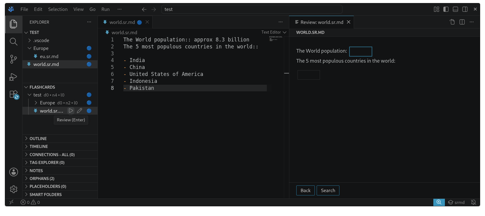

# srmd

A flashcard spaced repetition extension for Markdown suitable for knowlege base notes. Flashcards typically isolate facts, while knowledge-base notes organize related information and evolve over time. Keeping both synchronized duplicates work. Using unobtrusive cloze and scheduling Markdown syntax srmd generates flashcards from knowledge-base notes: note-taking first, spaced repetition second.



The Markdown notes are parsed with [micromark](https://github.com/micromark/micromark) with custom extensions. Reviews are scheduled with [ts-fsrs](https://github.com/open-spaced-repetition/ts-fsrs), the TS implementation of the [FSRS algorithm](https://github.com/open-spaced-repetition/awesome-fsrs/wiki/The-Algorithm).

```markdown
The World population:: approx 8.3 billion

The 5 most populous countries in the world:: 

- India
- China
- United States of America
- Indonesia
- Pakistan
```

Note taking comes first. A note stays readable Markdown and the extension syntax, srmd, is aimed at being as unobtrusive as possible with the FSRS scheduling stored in the note itself. Once a card has been reviewed, a card reference such as `[:1]` ends its first cloze and a one-line card definition holds its scheduling, at the end of the note unless the note already has definitions:

```markdown
The World population:: approx 8.3 billion[:1]

The 5 most populous countries in the world:: 

- India
- China
- United States of America
- Indonesia
- Pakistan

[:1]: k 20261016040000 1 20261015120000 2.3065 2.11810397 0 1 0
```
There is no database or srmd service. Notes move, rename and sync with whatever you already use, such as Git or Syncthing. Loading a note never rewrites it; only a review, or a manual scheduling hint the user wrote, saves it.

## Status

There are two applications: a **VS Code extension** and an **Android app**. The VS Code extension covers:

- A Flashcards view in the Explorer side bar for navigating flashcards and reviewing.
- Count badges in the regular Explorer (VS Code design choices are not optimal for srmd, there is no reliable way to display badges for folders as they get suppressed by the bubbling badge).
- A review tab that follows the VS Code theme.
- A reading view of notes in VS Code's Markdown preview, with every cloze shown and outlined.
- Warnings for notes whose card definitions a save would remove.
- Format Document for notes, which lays out their blocks and keeps what is written inside them, srmd and Foam syntax included.

It is off in every workspace until turned on, from the Command Palette or the status bar, so other projects are never scanned. See [apps/vscode/README.md](apps/vscode/README.md) for its features, commands, keyboard shortcuts and settings. It is not published to the Marketplace; build it from source as described under [Building the extension](#building-the-extension).

The **Android app** shows the notes folder you pick, full screen with every cloze outlined; swipe right for the folder tree with the cards' counts, swipe up to search the shown file. It reviews notes as the VS Code review tab does and edits files with CodeMirror, formatting Markdown as the extension does. See [apps/android/README.md](apps/android/README.md); build it as described under [Building the Android app](#building-the-android-app).

A browser application is planned. An iOS app will require someone else as I do not own a single Apple device. The code base is split into a portable components (`shared/`) and the platform specific components (`apps/`) to minimize the platform specific code.

## Documentation

| Document                                                     | Contents                                                                                                           |
|--------------------------------------------------------------|--------------------------------------------------------------------------------------------------------------------|
| [apps/vscode/README.md](apps/vscode/README.md)               | Using the VS Code extension                                                                                        |
| [apps/android/README.md](apps/android/README.md)             | Using the Android app                                                                                              |
| [apps/android/ARCHITECTURE.md](apps/android/ARCHITECTURE.md) | The Android app's design: the Kotlin shell, the web app and their message channel                                  |
| [SYNTAX.md](SYNTAX.md)                                       | Writing notes in srmd: clozes, card references and definitions, loading and saving                                 |
| [ARCHITECTURE.md](ARCHITECTURE.md)                           | The canonical design: cloze syntax, scheduling storage, matching, queues, loading and reviewing, and deferred work |
| [shared/README.md](shared/README.md)                         | The portable components and their API                                                                              |
| [shared/parser/README.md](shared/parser/README.md)           | The parser API and the note inspector                                                                              |
| [tests/README.md](tests/README.md)                           | Running and writing tests                                                                                          |
| [AGENTS.md](AGENTS.md)                                       | Code conventions and component boundaries                                                                          |

## Repository layout

A npm workspaces monorepo in TypeScript:

| Path                | Responsibility                                                                                                                            |
|---------------------|-------------------------------------------------------------------------------------------------------------------------------------------|
| `shared/parser/`    | srmd syntax (micromark extensions) on GFM, reference matching, rendering, saving and formatting notes                                     |
| `extensions/`       | Optional micromark extensions a host can turn on, such as [micromark-foam-placeholders](extensions/micromark-foam-placeholders/README.md) |
| `shared/scheduler/` | Manual hints, due-day balancing, FSRS, the note/folder tree, queues and counts                                                            |
| `shared/reviewer/`  | Host-independent review data: rendered note, choices with previewed intervals, rating mapping, problem texts                              |
| `shared/ui/`        | HTML review controls, keyboard shortcuts, search and the reviewer stylesheet, for web-based hosts                                         |
| `shared/l10n/`      | Message catalogs (English), compiled with [Paraglide](https://paraglidejs.com) into typed functions                                       |
| `shared/workspace/` | Loading, reviewing and saving a folder's notes over a host's file access, the same way in every host                                      |
| `apps/vscode/`      | The VS Code host: file access, file search and watching, the views, the review tab and the extension manifest                             |
| `apps/android/`     | The Android host: a web app on the shared components (`src/`) in a Kotlin shell around one WebView (`native/`)                            |
| `tests/`            | The test guide and the shared test setup                                                                                                  |

Hosts stay thin. They provide file access, configuration, resource URLs and a review surface, and the shared components do the rest. Each component has its own `src/`, `tests/`, `package.json` and `tsconfig.json`.

## Development

Install Node 20.19 or later, then install dependencies once at the repository root:

```sh
npm install
```

| Command                                      | Effect                                                                                                       |
|----------------------------------------------|--------------------------------------------------------------------------------------------------------------|
| `npm test`                                   | All tests: the optional extensions, the shared components, then both hosts                                   |
| `npm run test:<name>`, such as `test:parser` | One component's tests: `parser`, `scheduler`, `reviewer`, `ui`, `workspace`, `shared`, `vscode` or `android` |
| `npm run typecheck`                          | Type-check every component and both hosts                                                                    |
| `npm run build`                              | Bundle the extension into `apps/vscode/dist/` and the Android web app into its assets                        |
| `npm run apk`                                | Build the Android app's debug APK (see below)                                                                |
| `npm run parse -- path/to/note.sr.md`        | Inspect how a note parses, renders and would be saved, without changing it                                   |

Tests use Node's test runner and import TypeScript sources directly through `tsx`. The VS Code tests run the real extension and webview bundles against a mocked `vscode` module, so they need no VS Code installation. Running `npm test` in a component's directory runs only its tests. See [tests/README.md](tests/README.md) for filtering and conventions.

To try changes in VS Code, build, then start an Extension Development Host with `--extensionDevelopmentPath` pointing at `apps/vscode`, and open a folder of notes.

### Building the extension

```sh
npm run build:package
code --install-extension apps/vscode/srmd.vsix
```

`build:package` builds the extension and packages it with the locally installed `vsce` into `apps/vscode/srmd.vsix`. The extension needs VS Code 1.85 or later.

### Building the Android app

```sh
JAVA_HOME=/path/to/jdk npm run apk
adb install apps/android/native/app/build/outputs/apk/debug/app-debug.apk
```

`apk` bundles the web app into the Gradle project's assets, then builds the debug APK with Gradle. It needs a JDK 17 or later, one with `javac`, and the Android SDK, found through `ANDROID_HOME` or `sdk.dir` in `apps/android/native/local.properties`; the Android Gradle plugin installs the SDK platform and build tools it lacks. The app needs Android 10 or later. To try the web app without a device, `node apps/android/tests/browser.mjs <notes folder>` serves it with a stand-in for the Android shell, for a desktop browser's device emulation.

### Debugging the Android app

In VS Code, select **srmd: Android WebView** in Run and Debug and press F5. Its preparation task builds the APK,
reuses a connected device or starts the installed `pixel_test` emulator, installs the app without clearing its data,
and attaches the JavaScript debugger on port 9223. Breakpoints work in `apps/android/src/` and the shared TypeScript
components. To catch startup breakpoints, run `location.reload()` in the Debug Console after attaching.
Run `ANDROID_HOME="$HOME/Android" ANDROID_AVD_HOME="$HOME/Android/avd" npm run debug:android` for the same preparation
from a terminal; then the WebView is also available through
[Chrome's device inspector](https://developer.chrome.com/docs/devtools/remote-debugging).

The VS Code task selects the SDK at `~/Android` and virtual devices at `~/Android/avd`; change its environment entries
for another installation. The preparation script uses `ANDROID_HOME` (default `~/Android`) and `ANDROID_AVD_HOME`
(default `<SDK>/avd`), dropping the deprecated `ANDROID_SDK_ROOT` to avoid conflicting SDK locations.
Set `SRMD_ANDROID_AVD` for a different installed emulator, or `ANDROID_SERIAL` to select a connected
device when more than one is present. Java must be on PATH or selected through `JAVA_HOME`. Emulator startup output
goes to `apps/android/build/emulator.log`. Stop and restart debugging after changing code to rebuild and reinstall;
the emulator stays running. For Kotlin breakpoints, open `apps/android/native/` in Android Studio.

### Performance

There is one important hot path, on startup, regardless of platform, all relevant files will have to be read and parsed to establish scheduling queues - this needs to be fast in case of a large collection of notes.

### Dependencies

External dependencies use open-ended ranges (`>=` the version last tested), and `package-lock.json` pins what is installed. Update them deliberately and rerun all tests. The one exception is `@types/vscode`, which matches the minimum VS Code version in `engines.vscode`, so the typecheck rejects APIs that version lacks.

### Translations

User-facing text lives in `shared/l10n/messages/<locale>.json`, one file per language for every component and the host, and in `apps/vscode/package.nls*.json` for the extension manifest. To add a language:

1. add it to `locales` in `shared/l10n/project.inlang/settings.json`;
2. add `messages/<locale>.json`;
3. add `apps/vscode/package.nls.<locale>.json`;
4. add `apps/android/native/app/src/main/res/values-<locale>/strings.xml`.

### AI tools

The architecture and majority of code was originally hand rolled, AI tools were used to move this project from stalled to something runnable, detailed code review under way.

## License

[MIT](LICENSE)
