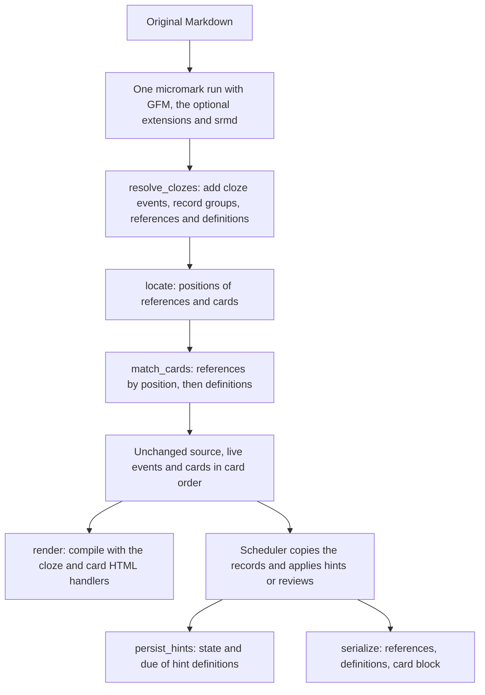

# Shared Markdown parser and inspection tools

This component implements the srmd syntax of [SYNTAX.md](../../SYNTAX.md), as
[ARCHITECTURE.md](../../ARCHITECTURE.md) describes, for both the application and
these inspection tools. GFM is built in; other micromark extensions are
optional parameters. A card reference ends a card's first cloze and names the
card definition holding its scheduling:

```markdown
Question:: answer[:1]

[:1]: k 20261012040000 7 20261005120000 8.5 4.2 0 10 1
```

## Try a note

Install workspace dependencies once at the repository root. From this directory:

```sh
npm run inspect -- tests/examples/reordered.sr.md
npm run inspect -- --serialize tests/examples/positioning.sr.md
npm run inspect -- path/to/note.md
cat path/to/note.md | node --import tsx tests/inspection.mjs
```

The default report shows the untouched Markdown, in-memory scheduling, the full
event stream, and HTML. It does not serialize. Add `--serialize` to inspect the
normalized Markdown and a reparse of that output as a separate save preview.
Each event includes its kind, token type, original source offsets, source text,
and any card ordinal or card reference. `--json` additionally exposes line and
column positions and each cloze's in-memory scheduling.

```sh
node --import tsx tests/inspection.mjs --json path/to/note.md
node --import tsx tests/inspection.mjs --serialize --json path/to/note.md
node --import tsx tests/inspection.mjs --source path/to/note.md > normalized.md
node --import tsx tests/inspection.mjs --html path/to/note.md > preview.html
```

From the repository root, `npm run parse -- path/to/note.md` runs the same inspector.

The script reads files without modifying them. `--source` and `--html` emit only
the requested output so they can be redirected. Manual hints and compact local
timestamps remain as written; inspection makes no scheduling decisions.

## API and lifecycle

The exported TypeScript API is in [src/index.ts](src/index.ts):

```ts
const note = parse(source, extensions)   // extensions: optional { syntax, html } pairs
// { source, events, extensions, scheduling, groups, references, definitions, hints, problems }

const html = render(note.events, { extensions: note.extensions })
// Each cloze, a span inline or a div block, has class="cloze", data-ordinal="ordinal" and data-card="[:ref]: state ...".

// On load, after the scheduler resolved the note's hints in a copy of the records:
const resolved = persist_hints(note.source, note.hints, current_cards)
// After a review changed a copy of the records:
const markdown = serialize(note, current_cards)
// When the user formats a note, options as FormatOptions; null when the result would render differently:
const formatted = format(source, extensions, options)
// The host writes the result. This API does not perform filesystem operations.
```

| Function        | Responsibility                                                             | Result       |
| --------------- | -------------------------------------------------------------------------- | ------------ |
| `parse`         | Find the syntax, give references to cards by position, match definitions   | `ParsedNote` |
| `render`        | Compile clozes with their current scheduling, hiding metadata              | HTML         |
| `serialize`     | Number and place references, update and sort definitions, remove the rest  | Markdown     |
| `persist_hints` | Replace the state and due fields of the hint definitions, and nothing else | Markdown     |
| `format`        | Lay out the blocks anew, keep inline content; null if rendering changes    | Markdown     |

An optional extension is a micromark pair: `syntax` for `parse()`, `html` for
`render()`. The parse records the extensions it used, so render with
`note.extensions`. They apply after GFM and before srmd; srmd syntax inside an
extension's tokens is text. GFM, the extensions and srmd are combined once per list
of extensions and shared by every note parsed with that list, so hosts keep one
list until their settings change.

`render()` also takes `scheduling`, replacement cards.

The scheduling array is always in **card ordinal order**: element zero belongs
to card 1. A matched definition gives its card its original positive `ref`, which
can differ from the ordinal. An unmatched card gets `-ordinal` and default
new-card data; temporary refs are never written to Markdown. Saved references are
numbered from 1 over the persisted cards, so they need not equal ordinals either.

All clozes of a group share one scheduling object, so editing
`note.scheduling[ordinal - 1]` in place shows in `render(note.events)`. With
replacement records, pass them to `render()` and `serialize()` alike.

Parsing and rendering do not normalize or write, and have no clock, random source
or FSRS dependency. Hints stay as written: `parse()` lists the cards whose
definitions hold one in `hints`, `Scheduler.create_note()` resolves them, and the
host saves them with `persist_hints()`. `problems` lists the definitions a
`serialize()` would remove (unclaimed ones and repeated identifiers), so hosts can
warn first. Serialization leaves its inputs unchanged; after writing its output, a
host parses that text again before the next save.

The pipeline trusts its typed inputs: events come from this parser, the parse
result is passed whole, and replacement scheduling has one valid record per card.
The tokenizers still check the Markdown grammar: an invalid construct stays
ordinary text. Malformed srmd, such as clozes straddling Markdown elements, has
best-effort output and is not repaired.

## Pipeline



Clozes and card metadata are Markdown extensions parsed with the original
source. Nothing removes metadata to build another Markdown document, so spaces
before `[:1]` are not trailing spaces and make no hard break.

### Tokenizers

[src/micromark\_srmd\_card.ts](src/micromark_srmd_card.ts) tokenizes references
(`[:1]`) in text; reference lines as blocks that, like a thematic break,
interrupt a paragraph, so they end a list, quote or table rather than continuing
its last line; and definitions where content starts, before link definitions, so
they cannot interrupt a paragraph. A definition, which must start with `[:`, so that
a line starting with a link is left at once, reads its whole line and
`read_definition()` validates it; an invalid line is left to other constructs and
ends up as text. At the start of a line or block, `[:1]:` is never a
reference, so a malformed definition stays as written.

[src/micromark\_srmd\_cloze.ts](src/micromark_srmd_cloze.ts) tokenizes openers
(two or more colons, an optional final semicolon, then `>` or whitespace) and
closers (`<` and two or more symbols). An implicit opener takes the spaces after
it. The tokenizers only annotate candidates: level, continuation, explicit.

### Resolving clozes

`resolve_clozes()` walks the events once, copying them and adding cloze enters
and exits. Markers stay in the stream:

- An opener followed in its paragraph or table cell by nothing but whitespace
  and card references (`at_text_end()`) is pending: the next block entering in its
  container gets a block cloze around it. Any other opener opens an inline cloze
  after itself. An implicit opener renders a colon, and the spaces it took when an
  inline answer follows on its line; explicit markers render nothing.
- An exit closes every cloze opened inside the exiting token, so an implicit
  inline cloze ends with its parent element. A hard break marks implicit inline
  clozes as closing; a closer marks the latest explicit cloze still awaiting one.
  A closing cloze closes once Markdown nesting returns to its opening depth, and
  an implicit block cloze after its block. An explicit cloze remembers where its
  closer ended, `_closer_end`.
- The group of each marker level is the latest one opened; a continuation joins
  it. A card is allocated with its group's first cloze. A marker that opens or
  closes nothing, and every marker or reference in a heading, becomes text.
- Definitions (marked root-level outside lists and quotes) and references (with
  their reference line) are recorded on `card_state`. A paragraph that renders
  nothing, holding only explicit markers and metadata, becomes
  `clozeEmptyParagraph`, which renders nothing.

### Positions and matching

[src/positions.ts](src/positions.ts) gives each reference the position it stands
at and each card the one position where its reference belongs, as keys:
`t<offset>` for the end of a text (the last content before it in its paragraph or
table cell, skipping whitespace, line endings and references) and `l<offset>`
for a reference line after the block starting at offset, at most one blank line
below it in the same parent.

| First cloze                                                        | Position                                                |
| ------------------------------------------------------------------ | ------------------------------------------------------- |
| Explicit, inline or block                                          | Directly after the closing marker                       |
| Implicit inline                                                    | The end of its content, inside the element it ends with |
| Implicit block ending in a paragraph                               | The end of that paragraph's text                        |
| Implicit block ending in any other block, a list or quote included | A reference line after that block                       |

`locate()` also records each card's **nesting**, the index of its first cloze's
exit, which orders cards sharing a position innermost first, and its
**insertion**: inline, with a space after an implicit marker, `!` or an odd run of
backslashes; or a new line with the containers' prefix, which ends the block,
after a blank line only for HTML kinds 6 and 7, which would take the line as
content.

[src/cards.ts](src/cards.ts) gives the references at each position, in reading
order, to the cards there, innermost first. Only then are definitions read: the
first definition of an identifier counts, later ones are duplicates, and each
card in ordinal order copies its reference's definition unless an earlier card
claimed it. A missing definition never moves a reference. For example, in
`Q:: first` followed by `Q:; second[:8]`, the continuation has no position, so
`[:8]` is misplaced: hidden, its definition reported as unclaimed, and both
removed by the next save.

### Rendering

[src/index.ts](src/index.ts) compiles the events with GFM, the optional
extensions', card and cloze HTML handlers. References render nothing; reference lines, definitions and
`clozeEmptyParagraph` are buffered and discarded with their whitespace. Each cloze
has class `cloze`, `data-ordinal` (its card's ordinal) and `data-card`, the card's
canonical definition, which needs no escaping. Which card is reviewed is left to
the reviewer:

```html
<p>Question: <span class="cloze" data-ordinal="1" data-card="[:7]: k 20261014040000 7 20261007120000 8.5 4.2 0 10 1">answer</span></p>
```

### Saving

[src/serialize.ts](src/serialize.ts) edits the original source; everything
between edits is copied verbatim. An edit replaces `source.slice(start, end)` with
text, in original-source offsets, so output length never shifts later edits.

1. **Select** the positions where a card with scheduling data belongs, with every
   card at them, and elsewhere the cards owning a reference, which keep it without
   data. Number the selected cards from 1 in card order.
2. **References**: at each selected position, write its cards' references
   innermost first over the first reference standing there, or at the insertion.
   Remove every other reference: with its line when nothing else is on it,
   otherwise with the space it would leave.
3. **Definitions**: rewrite the definitions of selected cards with data or a
   definition in place, except those in the card block (the last run of root-level
   definitions), which is rewritten sorted, with definitions added for cards with
   data. Remove all other definitions. Without root-level definitions, a new block
   goes at the end of the note.

A removed line takes the blank line above it when the line below is blank too
(or the note ends), so removals do not pile up blank lines.

```markdown
Fresh:: one

Known:: two[:7]

[:7]: k 20261012040000 7 20261005120000 8.5 4.2 0 10 1
```

saves as `Known:: two[:1]` with `[:1]: k …`. In `Q:: outer ::: inner`, both first
clozes end at the same place: saving only the inner card gives
`Q:: outer ::: inner[:2][:1]` with only `[:2]` defined, so a reload gives `[:2]`
back to the inner card.

`persist_hints()` replaces only the state and due fields of each hint
definition, adding a due field after the state when there is none.

There is no fence completion, HTML termination check or verification reparse:
unclosed code or HTML follows Markdown rules through the end of the note, even if
it swallows appended definitions, as with link reference definitions.

### Formatting

[src/format.ts](src/format.ts) formats a note through mdast, as
[ARCHITECTURE.md](../../ARCHITECTURE.md#formatting) describes:
`mdast-util-from-markdown` tokenizes the source with the parse's micromark
extensions and YAML front matter, reference lines and card definitions become
nodes of their own, and `mdast-util-to-markdown` writes the tree with srmd's
handlers and blank lines. The texts of paragraphs, headings, table cells and link
definitions are copied from the source, with container prefixes and trailing
whitespace left out, so escapes, links and srmd's inline syntax stay as written.
`FormatOptions` choose bullets, numbering and table delimiter rows, and may wrap
or join a paragraph's lines and respell emphasis; a text they rewrite is rendered
alone with its copy and keeps the copy when the two differ. `format()` renders the
result and the source and returns null when they differ in more than whitespace
that does not show.

## Event and tokenizer conventions

Each live event is `[kind, token, context]`. `kind` is `enter` or `exit`; both
events refer to the same token object. `context` is micromark's tokenizer context
and is needed for compilation. Keep event order intact: it represents structural
nesting, which cannot in general be reconstructed by sorting source offsets.

Public `start`/`end` offsets are half-open JavaScript string offsets (UTF-16 code
units) in the returned `source`. Lines and columns are one-based, with tabs
advancing to the next four-column stop. Tokenizer contexts and public points
both refer to the original input. Use source offsets to inspect text and retain
the contexts for rendering. Micromark's private buffer indices are not
interchangeable with source offsets.

The inspector deliberately creates JSON snapshots rather than serializing
these live contexts. Its `text` is the original source slice and `rendered_text`
is an opener's rendered text. These snapshots are for inspection, not input
to `render()`.

In the syntax extensions, each tokenizer function returns its initial state.
A state receives one code, calls `effects.consume(code)` when it owns that code,
and returns the next state. Returning itself consumes a run without recursion.
`ok` accepts the construct; `nok` rolls a speculative attempt back so another
Markdown construct can handle the text. Passing `ok(code)` leaves an unconsumed
boundary for that state; returning `ok` after consuming a character resumes on
the following code. `effects.attempt()` commits only on success, while
`effects.check()` performs lookahead. Negative codes represent tabs/virtual
spaces and line endings; `null` is EOF. A tokenizer's `this.previous` is the code
before its construct, which is how a reference tells that it starts a line.

## File map

| File                                                         | Main responsibility                                                             |
| ------------------------------------------------------------ | ------------------------------------------------------------------------------- |
| [src/index.ts](src/index.ts)                                 | Public pipeline: parse, resolve, locate and match, render; exports the save API |
| [src/micromark\_srmd\_cloze.ts](src/micromark_srmd_cloze.ts) | Marker tokenizers, cloze resolver and cloze HTML handlers                       |
| [src/micromark\_srmd\_card.ts](src/micromark_srmd_card.ts)   | Reference, reference line and definition tokenizers and their HTML handlers     |
| [src/positions.ts](src/positions.ts)                         | Positions of references and cards, nesting and insertions                       |
| [src/cards.ts](src/cards.ts)                                 | Ownership, definition claims, hints, card creation and the canonical definition |
| [src/serialize.ts](src/serialize.ts)                         | `serialize()` and `persist_hints()` source edits                                |
| [src/format.ts](src/format.ts)                               | Formatting through mdast: srmd nodes, copied texts, blank lines                 |
| [src/types.ts](src/types.ts)                                 | Shared records and micromark type extensions                                    |
| [tests/inspection.mjs](tests/inspection.mjs)                 | The note inspector                                                              |

Tests are in [tests/](tests/), one file per topic: markers, references, saving,
definitions, hints, nesting, boundaries, rendering, the full pipeline, Markdown
interplay, optional extensions, transcription and formatting. See the
[repository test guide](../../tests/README.md) for commands and conventions.
